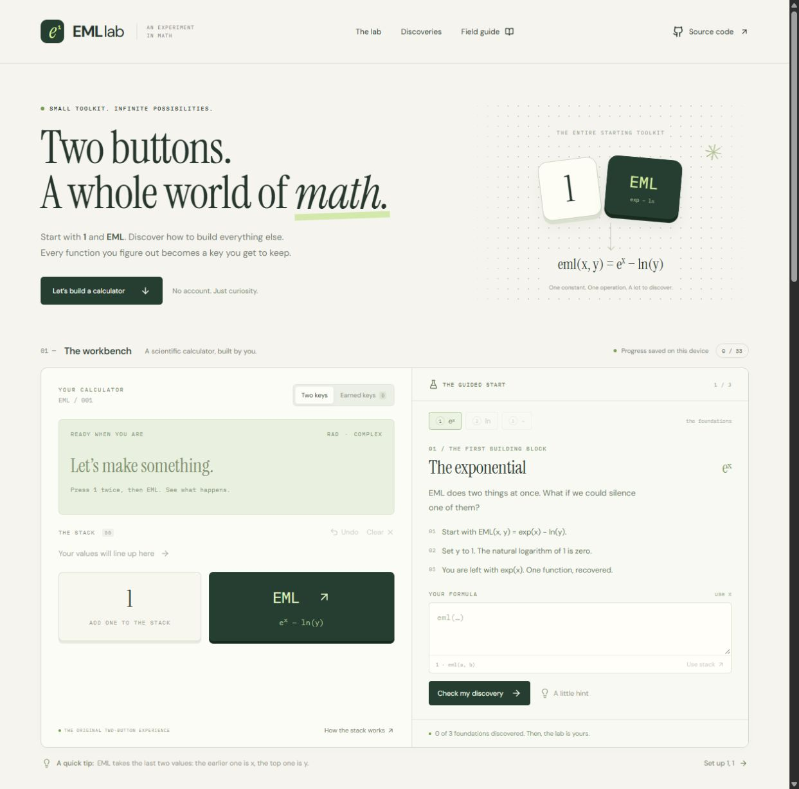

# EML Lab

**Two buttons. A whole world of math.**

An interactive, no-account math lab: begin with **1** and **EML**, recover
exponential, logarithm and subtraction, then solve challenges to grow a
scientific calculator. Every earned key shows its EML construction.



## Run locally

Use Node.js 24 and npm.

```sh
npm ci
npm run dev
```

Open the local URL printed by Vite. To verify and build:

```sh
npm test
npm run build
npm run preview
```

The automated suite currently contains 83 tests. GitHub Actions also checks
the tests and production build on Linux. Desktop and 390-pixel phone layouts,
guided unlocks, saved-progress recovery, earned keys and expression inspection
have been checked in a browser.

## Deploy to Vercel

[](https://vercel.com/new/clone?repository-url=https%3A%2F%2Fgithub.com%2Fvardgrig%2Feml-calculator)

Import this repository in Vercel and deploy with the **Vite** preset.
`vercel.json` specifies the build (`npm run build`) and output (`dist`).
There are **no environment variables, authentication providers, API keys,
server functions, or database services** to configure. Subsequent Git pushes
can deploy through Vercel’s GitHub integration.

## How it works

```text
eml(x, y) = exp(x) − ln(y)

exp(x) = eml(x, 1)
ln(x)  = eml(1, eml(eml(1, x), 1))
x − y  = eml(ln(x), exp(y))
```

The calculator uses a stack: `1` pushes a value; EML consumes the last two
values (earlier = x, top = y). `1 → 1 → EML` yields e. Undo and Clear edit
the calculation. Earned-mode digits each push a separate value; the number
entry field builds multi-digit/decimal expressions from earned primitives.

33 discoveries include the foundations, 0 and 2–9, e, i, π, negation,
addition, multiplication, division, powers, roots, reciprocal, square,
base-10 log, trigonometric and inverse trigonometric functions, and sinh,
cosh, tanh. All angles are in radians.

Function challenges accept x/y placeholders and test multiple real inputs.
Only `1`, EML and earned names may be used. Hints include optional worked
solutions. Success adds a shortcut to the earned keypad; the code icon
shows the pure EML expansion, tree depth and button count.

## Progress and privacy

Progress is stored under `eml-lab.progress.v1` in localStorage. There is no
registration, analytics, tracking cookie, or server-side progress database.
It persists across visits on the same browser and origin. Browser data
clearing removes it; private browsing may be temporary. Export/restore lets
visitors back up or transfer progress. Blocked storage displays a notice.
Google Fonts are loaded for typography; system fallbacks work if blocked.

Unlocks are a local educational feature, not tamper-resistant credentials.
The restore path validates the storage version, known IDs and dependencies.

## Mathematical and numerical scope

Complex intermediates are necessary for i, π and trigonometry. Raw EML uses
a logarithm with argument in [−π, π), so the EML-derived logarithm agrees
with principal ln on negative real inputs. Earned ln/powers/scientific keys
use standard principal complex values. Branch cuts mean an expanded recipe
is not a universal identity over arbitrary complex inputs.

Recognized recipes and earned keys use stable mathematical identities and
native double-precision complex operations (`complex.js`). That avoids huge
intermediate exponentials and provides continuous arithmetic extensions at
zero where appropriate. An inspection expansion is the mathematical recipe;
it is not a claim that naively evaluating every expanded EML node gives the
same floating-point result. Raw EML still computes exp(x) − ln(y), with an
extended-real ln(0) limit. Undefined operations show an error.

Challenge tests are numerical evidence, **not symbolic proofs**. Inputs,
formula size, nesting, stack size, history and expansion work are bounded.
There is no JavaScript `eval` or arbitrary code execution in the parser.

## Project structure

- `src/engine.ts`: expressions, definitions, bounded parser, EML compiler,
  stable evaluation, challenge verification.
- `src/progress.ts`: versioned progress decoding and dependency repair.
- `src/App.tsx`: lessons, stack calculator, earned keys, challenge collection,
  progress controls, field guide and credits.
- `src/engine.test.ts`: every worked challenge and primitive compilation,
  numeric edge cases, parser boundaries and progress recovery.
- `.github/workflows/ci.yml`: tests and production build on pushes/PRs.
- [PLAN.md](PLAN.md): product and implementation plan.
- [Video notes](docs/VIDEO-NOTES.md): verified attribution and research limits.

## Inspiration and attribution

Inspired by [A Two-Button Calculator That Does Everything](https://www.youtube.com/watch?v=LxVW3b8jVdE)
from **Numberphile**, presented by **Dr James Grime**, video by **Brady Haran
and Pete McPartlan**. See Numberphile’s
[official companion page](https://www.numberphile.com/videos/a-two-button-scientific-calculator)
and [James Grime’s website](https://www.singingbanana.com/).

The EML operator and mathematical construction are due to **Andrzej
Odrzywołek**, [All elementary functions from a single operator,
arXiv:2603.21852v2](https://arxiv.org/html/2603.21852v2).

This independent project’s implementation, lesson text and visual design are
original. No video footage, transcript, logos or third-party calculator code
are included. No affiliation or endorsement is implied. Code is MIT-licensed;
third-party media and dependency licenses remain their own.
